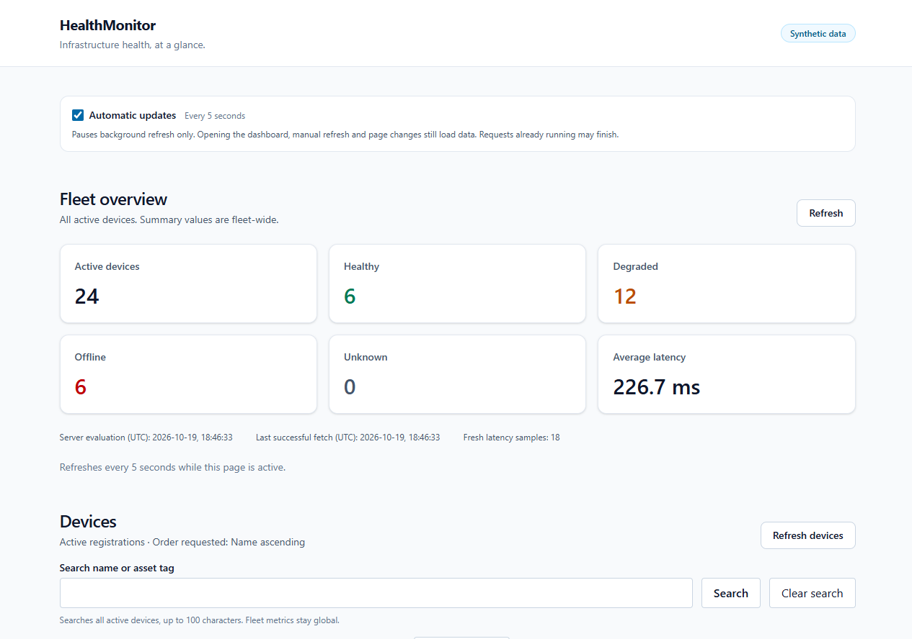
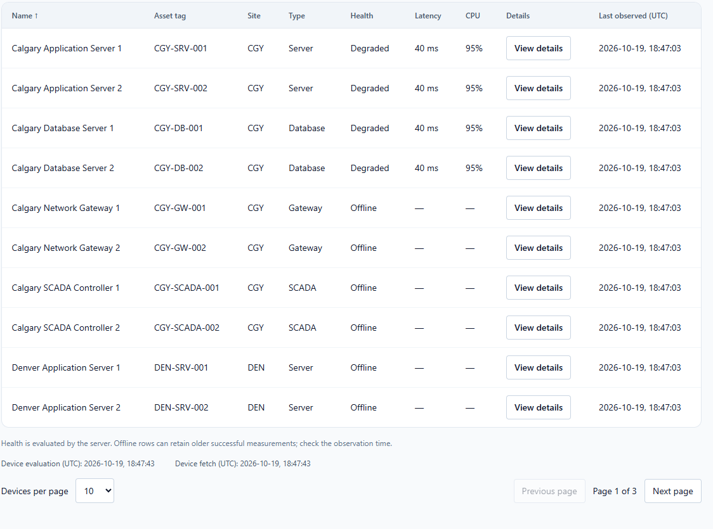
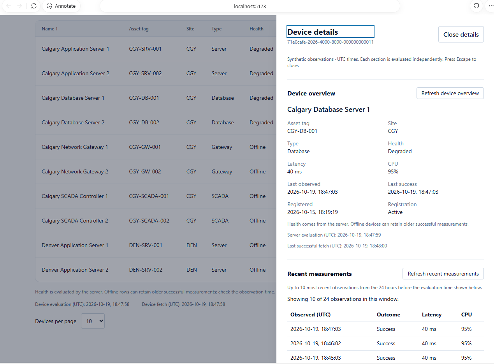
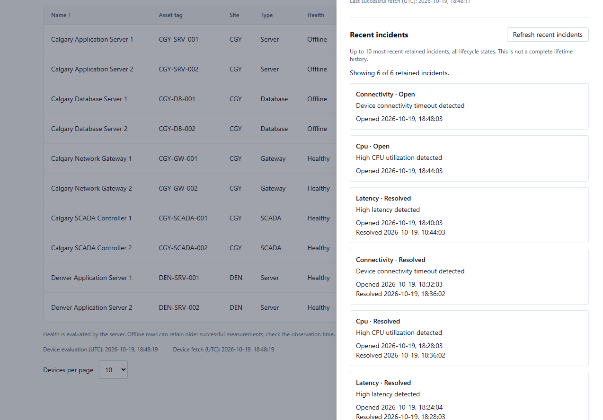

# HealthMonitor

HealthMonitor monitors a fictional infrastructure fleet using device registrations, simulated telemetry, health assessments and incident history. Its intended dashboard helps users find unhealthy devices and inspect their recent measurements and incidents.

**Current state:** the backend APIs and persistence foundations are implemented and tested. The React frontend includes fleet metrics and a server-paged device grid with refresh and failure states. Global name/asset-tag search, filters, server-side sorting and a device details panel are implemented. The AI interface remains a future enhancement. Verification evidence and remaining limits are recorded in the progress document. AI translation is disabled in production composition.

## Functionality

- Read-only fleet metrics and device grid, with page-size choices, previous/next controls, page totals and explicit stale-data warnings.
- Search all active devices by literal name or asset tag, then use Search or Clear search. Site, Type and Health dropdowns apply immediately and combine with applied search using AND; they do not submit unfinished search text. Clear search removes text only; Clear all filters also resets the dropdowns. Applying a search or selecting a filter resets to page one and retains page size; editing the text alone sends no request. Fleet metrics remain global. Previous results retain their search and filter labels while a new request loads or fails.
- Supported column headers toggle server-side ascending/descending order, with one active sort and a page-one reset that preserves filters and page size. Type is unsortable. Missing values stay last in either direction; ascending health order is Offline, Degraded, Unknown, Healthy. Header arrows show requested order; retained rows keep their previous order description until a response arrives. Clear all filters also restores Name ascending.
- A shared Automatic updates control for the dashboard and open device details. Your choice is remembered in browser storage when available; pausing stops background refresh, while initial loading, manual refresh and page navigation still work. Requests already running may finish.
- Device catalog and fleet summary APIs, with validated filtering, sorting and pagination.
- A device details panel with registration/health facts, up to 10 recent measurements from the server's trailing 24-hour window, and up to 10 retained incidents across lifecycle states. Each section has independent refresh, error and stale-data handling; the previews do not represent complete lifetime history.
- Atomic telemetry ingestion with idempotency, incident lifecycle processing and concurrency safeguards.
- An optional telemetry producer, retention processing and a separately controlled local simulation API.
- A provider-neutral AI query contract, strict proposal validation and bounded Groq/OpenAI transports. Local admission controls have automated coverage, but remaining configuration, operational controls and activation are incomplete. No live model evaluation is claimed.

All inventory and telemetry are synthetic. This application is not connected to real infrastructure and should not be used for confidential operational data without a separately designed access policy.

## Screenshots

Original browser captures provided by the owner from the running local application, using synthetic data. These were captured at different moments; measurements and incident states can differ between images.

Fleet overview with 24 devices and health totals:



Paged inventory with measurements and per-device details:



Device registration, current measurements and recent observation history:



Retained open and resolved incidents in the scrolled details panel:



## Architecture

The backend is a .NET 10 modular application with a single ASP.NET Core facade:

```text
React client — fleet metrics, paged device grid and device details
            |
ASP.NET Core API — HTTP contracts and composition
            |
Application — use cases and ports
            |
Domain — business rules and invariants

Infrastructure — port implementations, EF Core and PostgreSQL
                 separate Device and Telemetry contexts/schemas
```

TanStack Query owns response data and cache; Zustand holds ephemeral device selection and the shared, nonsecret updates preference; only the updates choice is persisted. Device owns registrations; Telemetry owns measurements and incidents. Application contracts preserve that ownership while the API composes read results. AI translates text into a validated filter proposal; it has no database or write-use-case access. Applying a proposal will use the ordinary read APIs.

| Location | Responsibility |
| --- | --- |
| `src/backend/HealthMonitor.Api` | Facade, policies and service composition |
| `src/backend/HealthMonitor.Application` | Use cases, query contracts and ports |
| `src/backend/HealthMonitor.Domain` | Domain rules and models |
| `src/backend/HealthMonitor.Infrastructure` | PostgreSQL persistence and provider adapters |
| `src/frontend/health-monitor-web` | React, TypeScript, Vite and Tailwind frontend; fleet metrics and paged device grid |
| `tests` | Backend unit, HTTP and isolated PostgreSQL tests |
| `scripts` | Strict integration-result verification and its database-free self-tests |

## AI query status

Planned flow: enter a natural-language request, review a server-validated preview of supported filters and sorting, then select **Apply** to fetch matching rows through the existing device-grid GET API. The model never executes SQL or accesses the database. Manual filters remain available; grid refresh does not call the model again. The AI panel, translation client and Apply integration are not implemented. The backend translation route is optional and disabled by default.

GroqCloud with `openai/gpt-oss-20b` is the selected implementation target. Each installation must use its own provider account and backend-stored API credentials, independent of the project owner's account. Set `AiQueries:ApiKey` only in API user-secrets or hosting secrets; never publish its value. Never put provider credentials in browser code or Vite environment variables. Complete the installation settings and budget provisioning before setting `AiQueries:Enabled=true`; restart to capture the installation snapshot.

Groq and OpenAI now have implemented, controlled-tested transports behind fixed supported profiles: Groq uses `openai/gpt-oss-20b`; OpenAI uses `gpt-5.4-mini-2026-03-17`. Backend composition selects one fixed profile per installation with `AiQueries:Provider` (`Groq` by default, or `OpenAI`). It validates one immutable snapshot using the actual host paths and lazily owns the admitted provider runtime. No live-provider result is claimed. Other models/providers are not automatically compatible: they need a reviewed profile/protocol or adapter behind the existing Application port. There is no automatic fallback or arbitrary browser-supplied endpoint, and changing only a key cannot select another provider. See the [provider decision and portability status](docs/development/AiProviderDecision.md#installation-credentials-and-provider-portability) and [implementation progress](docs/development/ImplementationProgress.md).

### Initialize the AI budget counter once

Pre-create a private persisted directory outside the actual served web root, accessible only to the API account. Configure `AiQueries:BudgetCounterPath` to a new absolute file path in that directory through API operator configuration. On Unix, newly created counter/sidecar files use owner read/write permissions; Windows inherits the presecured parent ACL. The command does not grant permissions or prove directory ownership, ACLs, hosting exposure or resistance to path swaps. It rejects linked/reparse parents and sidecars; the trusted private parent remains an operational prerequisite.

From the repository root, run `dotnet run --project src/backend/HealthMonitor.Api --no-launch-profile -- --provision-ai-budget`. Supply the path through the configuration available to that environment. Use the command flag as the sole argument. The helper reads only the counter path; the standard application builder still loads its normal configuration providers before that helper runs. The command exits before database registration, migrations, producer/retention or HTTP startup. It does not enable AI, validate a real provider account or call a model.

The command takes the runtime's exclusive stable `.lock` and creates only a new version-1 counter with the current UTC day and count zero. Every existing counter is refused, including old, nonzero, corrupt, partial or linked files. Never delete/reset an existing counter to bypass the daily budget. If cancellation or I/O fails, inspect the retained state before retrying; a partial or complete new file may exist. The file contents are flushed, but the parent directory is not fsynced; crash/power-loss durability is not verified. The stable sidecar is retained. Missing/corrupt state still fails closed in runtime; there is no automatic bootstrap or repair. Leave AI disabled until the private counter and provider account are ready. Configure `AiQueries:Enabled`, `AiQueries:Provider`, `AiQueries:ApiKey` and `AiQueries:BudgetCounterPath` through backend settings; fixed limits, models and endpoints cannot be overridden. Use one API replica per counter: client/global admission is process-local, and the stable counter lock excludes another owner. Set an appropriate spending cap with the provider as an additional operational control. Keep framework automatic forwarding disabled; any reverse proxy requires explicit `TrustedIngress` one-hop settings and deployment verification. Controlled local acceptance does not prove hosted TLS/proxy topology, filesystem permissions, real account access or model accuracy.

## Get started without a database

Install the .NET SDK specified in [global.json](global.json) (10.0.400, with serviced patch roll-forward). From the repository root:

```powershell
dotnet build tests/HealthMonitor.UnitTests/HealthMonitor.UnitTests.csproj -c Release
dotnet test tests/HealthMonitor.UnitTests/HealthMonitor.UnitTests.csproj -c Release --no-build --filter "Platform!=Unix"
```

These Windows commands build the backend and run unit tests without PostgreSQL, provider credentials or a running application. Four explicitly Unix-only provisioning/link/permission cases are excluded on Windows; Linux CI runs the unfiltered suite, and Linux local runs should omit the filter. They may restore NuGet packages. Build backend projects explicitly: the solution also contains an independent JavaScript project.

To start the frontend, use Node.js 24.15 or newer within the 24 LTS line, with npm in a separate terminal. Create `.env.local` from `.env.example` if it does not already exist, or update only its public `VITE_API_BASE_URL`. The example matches the checked-in API HTTPS profile (`https://localhost:7080`); it contains no provider credentials:

```powershell
cd src/frontend/health-monitor-web
npm ci
npm run dev
```

Start the API using the prerequisites below to load real summaries. The development server uses `http://localhost:5173`, matching the API CORS origin; an occupied port fails rather than silently selecting a different origin. Without a configured or reachable API, the screen shows a setup/error state.

## Run the API

A running API needs a prepared PostgreSQL database and an explicitly configured restricted runtime account. Follow the architecture plan's [local configuration and startup](docs/architecture/Enterprise%20Infrastructure%20Health%20Monitor%20Technical%20Architecture%20Plan.md#6-secrets-local-startup-and-bootstrap-checks) and [migration procedure](docs/architecture/Enterprise%20Infrastructure%20Health%20Monitor%20Technical%20Architecture%20Plan.md#10-migrations-and-consistency) before starting it:

```powershell
dotnet run --project src/backend/HealthMonitor.Api --launch-profile https
```

The checked-in HTTPS profile uses `https://localhost:7080`; a trusted local development certificate is required. Runtime credentials belong in user secrets or hosting secrets under `ConnectionStrings:HealthMonitorRuntime`. Maintenance credentials use a separate key and privilege boundary; never substitute them for the runtime account or commit credentials. API startup does not apply migrations or provision the catalog.

The public read routes include `/api/v1/metrics/summary`, `/api/v1/devices`, and device detail/history routes. Simulation and the producer require explicit enablement. AI routing remains disabled; trusted ingress parsing alone does not configure forwarding or complete AI activation. Ordinary reads do not depend on AI availability.

## Run a populated synthetic demo

Use your own dedicated PostgreSQL database; downloaders do not share this project's database or credentials. PostgreSQL is required by the existing persistence implementation. For Supabase, use the project's direct connection or session pooler on port 5432, with certificate validation (`SSL Mode=VerifyFull`); the transaction pooler on port 6543 is unsupported.

1. Follow the architecture plan's [database provisioning and privileges](docs/architecture/Enterprise%20Infrastructure%20Health%20Monitor%20Technical%20Architecture%20Plan.md#23-database-provisioning-and-privileges). Keep Device and Telemetry schemas private. The runtime account needs catalog SELECT and the specified Telemetry permissions, without catalog writes, ownership or schema creation privileges.
2. Configure the separate runtime and maintenance connection strings in local .NET User Secrets for the API project, following the linked configuration procedure. Do not put them in `.env.local`, source files, command history or screenshots. Apply Device migrations before Telemetry migrations using the maintenance account. Skip already applied migrations; never reset an existing database to prepare a demo.
3. In Development mode, run the explicit `--provision-devices` maintenance command described in the architecture plan. It creates the fixed 24-device catalog and exits; normal API startup does neither provisioning nor migrations. Verify the selected target before any maintenance operation.
4. Ensure the localhost HTTPS development certificate is valid and trusted. `dotnet dev-certs https --check --trust` checks both. If trust is missing, `dotnet dev-certs https --trust` requests a local trust change; approve it only on your own development machine.
5. From the repository root, start one API with explicit demo-only settings. These command-line overrides apply only to that process; they do not change user secrets, configuration files or the shell environment:

```powershell
dotnet run --project src/backend/HealthMonitor.Api --configuration Release --launch-profile https -- `
    --DemoProducer:Enabled=true `
    --DemoProducer:IntervalSeconds=60 `
    --AiQueries:Enabled=false `
    --Simulation:HttpEndpointEnabled=false `
    --Simulation:AllowLocalAnonymous=false
```

Keep `DemoProducer:IntervalSeconds=60`, AI disabled, and both HTTP simulation flags disabled for this walkthrough. Run only one producer against the database. Normal startup immediately runs retention before its periodic schedule; select a dedicated synthetic dataset and do not point this demonstration at unrelated operational data. Stopping the API stops production, but committed synthetic history remains subject to retention.

6. Start the frontend as described above, using `https://localhost:7080` as its public API URL, and open `http://localhost:5173`. Keep the API origin and frontend CORS origin exact; avoid certificate exceptions. After the first minute, the producer supplies four six-device groups: Healthy, HighLatency, HighCpu and Timeout. Groups rotate after four scheduled observations, so allow several minutes to see measurement changes and incident recovery. A timeout has no latency/CPU measurement; a missing value is not zero.

For a short walkthrough, keep Automatic updates enabled and compare observation timestamps across a minute boundary. Filter for Degraded or Offline devices, open **View details**, and inspect measurements and retained incidents. Return to all health states to see recovery when groups rotate. Exercise Search/Clear search, sorting, then pause updates and use manual refresh. In the details panel, check keyboard focus, Tab containment, Escape, focus restoration and narrow-screen scrolling in a real browser. Section timestamps can differ because their reads are independent.

Useful screenshots show the populated fleet, a filtered unhealthy view, and a device's measurements/incidents. Capture actual browser output without developer tools, credentials or connection settings; label the data as synthetic. Screenshots and automated component tests do not establish complete accessibility or hosted production acceptance.

## AI-assisted development

The owner did not personally write the application code. AI coding agents generated the implementation and tests. The owner helped organize the architecture plan and guided the first two development steps to establish the working method.

The owner then established separate AI development and read-only reviewer chats, both following the working method demonstrated in the first two steps. The reviewer checks the development thread's plans and implementation for errors and gaps, requests corrections, and examines test evidence. This is AI-assisted review, not human line-by-line code review.

Work proceeds in small increments with local checks and GitHub Actions verification. The progress log distinguishes implementation, source review, local execution and CI evidence; these checks do not establish hosted production readiness.

## Verification and development

[GitHub Actions](https://github.com/alickqiu1/HealthMonitor/actions/workflows/healthmonitor-ci.yml) builds and tests the backend, provisions disposable PostgreSQL, applies both schema migrations, and verifies required integration cases. Database tests must target the dedicated, verified `healthmonitor_test` database; never point them at development or production Supabase. A separate frontend job runs lint, client/component tests and the production build. Those tests use controlled responses; they do not prove a live browser-to-API journey or live AI behavior. Run `npm test`, `npm run lint` and `npm run build` from the frontend directory for the same local checks.

- [Implementation progress](docs/development/ImplementationProgress.md): current milestone, approved roadmap, executed test evidence and known gaps.
- [Technical Architecture Plan, Edition 1.5](docs/architecture/Enterprise%20Infrastructure%20Health%20Monitor%20Technical%20Architecture%20Plan.md): authoritative requirements, module boundaries, setup and operational procedures.
- [AI provider decision](docs/development/AiProviderDecision.md): selected provider/model, rationale and remaining evaluation limits.

The bounded synthetic-data demonstration, device details panel, startup walkthrough and actual screenshots are delivered. The owner reported that the populated output and details look correct and that Tab navigation works. Escape/focus-return behavior and specific narrow-screen layouts have not been manually confirmed; the progress document records these limits separately from automated coverage. Frontend AI translation/preview/Apply and operational provider/deployment acceptance remain open; resume it from the progress document rather than treating tested components as an enabled feature.
