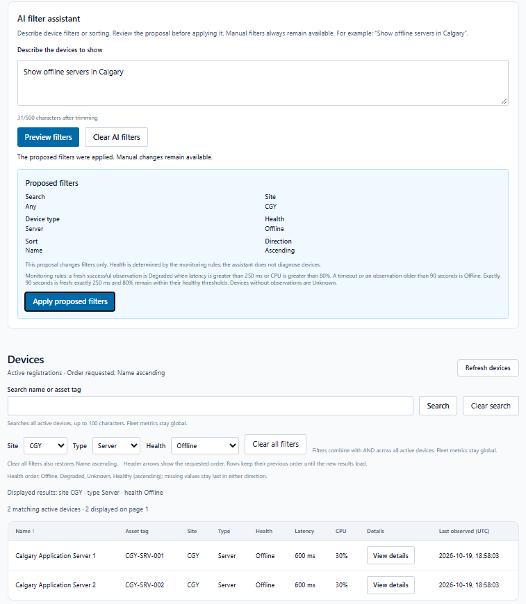

# Synthetic demo guide

A 60–90 second walkthrough of the existing application. Use the [README setup](../../README.md#run-a-populated-synthetic-demo) and [verification closeout](../development/VerificationCloseout.md) first. The data is fictional; this is a local demonstration, not evidence of a public production deployment.

## Prepare

Use your own dedicated database and credentials. Keep maintenance separate from runtime, apply Device migrations before Telemetry, and explicitly provision the fixed catalog using the documented procedure. Do not reset an existing dataset. Normal API startup runs retention immediately; the optional producer writes synthetic observations every 60 seconds when enabled. Start only one producer and allow several cycles if demonstrating incident recovery.

The default demonstration keeps AI and HTTP simulation disabled. The optional AI segment below uses the existing authentic screenshot; it requires **no new model call**. Enabling live AI is a separate operator decision requiring a provider account, private counter, limits and explicit budget authorization. A grid refresh or applying a preview uses ordinary reads, not another model submission.

## Walkthrough / storyboard

| Time | Show | Suggested narration |
| --- | --- | --- |
| 0–10 seconds | Fleet overview | “HealthMonitor displays a synthetic infrastructure fleet, its health and recent incidents.” |
| 10–25 seconds | Metrics, device health and observation timestamps | “The server derives health from observations. The observed time is the stored telemetry observation time, not when this screen rendered; reads also report their own snapshot times.” |
| 25–40 seconds | Apply a manual site/health filter, change sort, open View details | “Filtering and sorting run across the active fleet on the server. Device details show bounded measurement and incident previews with independent refresh states.” |
| 40–65 seconds | The existing AI preview screenshot below, labeled as a still | “The optional assistant proposes supported filters. A user reviews them and explicitly applies them through the same read API. It cannot run SQL or change data. This capture shows two Calgary offline servers.” |
| 65–90 seconds | Return to dashboard, then verification links | “Device and Telemetry retain separate ownership. Atomic ingestion, concurrency checks, backend and frontend tests support the demonstration. The verification record states the remaining browser, deployment and operational limits.” |

This is an unaltered owner-provided browser capture, not a recording of the storyboard. Its old observations and Offline states are consistent with a stopped producer. Stored latency/CPU readings remain historical measurements; a missing measurement is not zero. The agent's separate single-request Groq acceptance was HTTP-only. Five owner screenshots after Apply were independently reviewed; they do not prove pre-Apply behavior, request counts or broad model accuracy.

Additional authentic views: [fleet](../screenshots/fleet-overview.png), [grid](../screenshots/device-grid.png), [details](../screenshots/device-details.png), [incidents](../screenshots/device-incidents.png). Captures were taken at different times, so their values need not match.

## Recording and manual checks

- Record only the running UI and public evidence pages. Hide account settings, developer tools, secret files, connection strings, private counter paths and credentials. Label the dataset synthetic and label any still image explicitly.
- If showing moving telemetry, compare observation times across a minute boundary. A stopped producer eventually gives stale/Offline health; do not describe retained measurements as fresh or claim every device is healthy.
- Verify the actual browser before recording: open details, keep Tab focus within the panel, close with Escape and confirm focus returns to its button; check narrow-screen scrolling. Also check the saved Automatic updates preference and pause/resume/manual behavior. These checks remain incompletely confirmed; automated DOM tests do not replace them.
- Preserve accurate [AI-assisted development attribution](../../README.md#ai-assisted-development). Describe the architecture, tests and decisions you can explain; do not imply human line-by-line authorship or full production acceptance.

No video was created in this closeout because a working capture route was not established. This guide is a recording script, not recorded-video evidence. See the [progress log](../development/ImplementationProgress.md) for historical milestones and the [verification record](../development/VerificationCloseout.md) for exact results and outstanding release gates.
